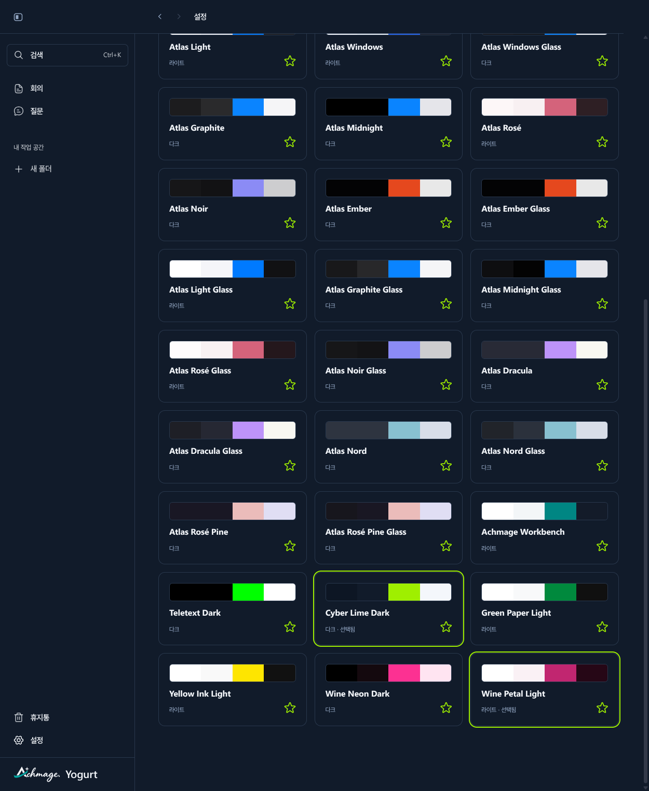

# Achmage Yogurt

한국어 중심 녹음·외부 음성 전사와 맥락을 확인하는 기록 정리 도구입니다. [Frigade Yogurt](https://github.com/FrigadeHQ/yogurt)를 기반으로 만든 Achmage 개인 확장판입니다. 원본 Yogurt와 독립된 앱·프로필을 사용합니다.

- 마이크·컴퓨터 소리 녹음과 로컬 Whisper 전사
- 음성·영상 드롭, 기존 TXT/MD/SRT/VTT/Whisper JSON/PDF/DOCX 전사 가져오기, 음성과 전사 함께 가져오기
- Plaud 공식 MCP 연결: 기존 전사·화자·정리본 가져오기 → Achmage 정리 준비, 선택적 원음 보관 및 별도 로컬 재전사 ([사용법](docs/PLAUD.md))
- 서로 다른 기록의 구독 AI 정리 병렬 실행, 기록별 진행 표시와 취소·알림 관리
- YouTube 자막의 롤링 중복 정규화, 원문 언어 자막 우선 선택, 기존 자막 재사용
- 전체 문서 최종 편집: 중복 주제 통합, 개념·절차·비교 중심 구성, 본문 타임라인 생략과 별도 근거 보기
- YouTube 개별 링크: 로컬 음성 전사 또는 기존 자막 가져오기 구분, 구간 선택, 작업 상태·중단·재시작
- 회의·강의·세미나·콜로퀴움·인터뷰·대화 정리: 사전 자료, 발화자 단서, 링크, 문서·이메일·이미지 첨부
- 선택한 로컬 볼트, 연결된 Gmail, 공개 웹의 근거 대조와 필요한 확인 질문
- 기본 GPT-6.2 Sol / xhigh, 앱 설정에서 구독 AI 모델·추론 강도·Whisper 모델 선택
- Markdown Live Preview / 읽기 / 원문 편집, 자동 저장, 이전 버전 복원과 새 정리본 비교·적용
- Achmage SVG 로고, Atlas 색상을 참고한 20종 + Achmage Workbench + 참고 스크린샷 6종 = **27개 스킨**

## 설치

[Releases](https://github.com/laguna821/achmage-yogurt/releases)에서 플랫폼에 맞는 파일을 받으세요. 공개 배포본은 로그인 없이 다운로드할 수 있습니다. 현재 버전은 **0.6.2-achmage.4**입니다.

| 플랫폼 | 파일 | 상태 |
| --- | --- | --- |
| Linux x64 | AppImage | 이 노트북에서 검증 |
| Windows x64 | EXE | Linux 교차 빌드, 실기기 검증 필요 |
| macOS Apple Silicon | ZIP 안의 Achmage Yogurt.app | Linux 교차 빌드, macOS 14.4 이상, 실기기 검증 필요 |

서명과 Apple 공증은 생략했습니다. Windows·macOS는 운영체제의 출처 확인 절차가 나타날 수 있습니다. Mac ZIP의 앱을 Applications로 옮겨 실행합니다. Mac Intel 빌드는 포함하지 않았습니다.

모델은 설치본과 별도입니다. 첫 실행에서 로컬 Whisper를 준비합니다. large-v3-turbo Q5_0 약 574MB이며, 설정에서 더 작은 Whisper 모델도 선택할 수 있습니다. 구독 AI는 해당 기기의 ChatGPT/Codex 로그인이 필요합니다. 외부 AI 정리는 구독 사용량을 소비합니다.

## 처음 사용하기

1. 홈에서 녹음하거나 **음성·전사 가져오기 / YouTube 링크**를 누릅니다. Plaud 등의 녹음 파일도 직접 넣을 수 있습니다. 음성+기존 전사를 함께 넣으면 재전사를 생략합니다.
2. 기록에서 **정리 설정**을 열어 녹음 종류, 결과 형태, 발화자 단서와 참고 자료를 넣습니다. 자료 없이 시작할 수도 있습니다.
3. 필요한 맥락이 해결되지 않으면 앱의 확인 질문에 답합니다. 기존 문서를 다시 정리한 결과는 후보로 보관하여 비교 후 적용합니다.
4. 정리본을 클릭해 편집합니다. 원문 Markdown은 그대로 보존하며 자동 저장됩니다.
5. 설정의 **스킨·모양**에서 라이트·다크 팔레트를 따로 선택하고 즐겨찾기에 넣습니다.

Gmail은 설정에서 본인의 Google OAuth 데스크톱 클라이언트를 등록하고 로그인해야 합니다. 연결 전에는 메일을 검색하지 않습니다. 카카오톡은 TXT 내보내기·본문·스크린샷 첨부로 받으며 카카오 계정에 직접 로그인하지 않습니다. 볼트 검색은 읽기 전용입니다.

## 데이터와 현재 범위

- 기존 `Yogurt` 프로필을 일관된 SQLite 스냅샷으로 복사해 `Achmage Yogurt` 프로필을 만듭니다. 원본 앱·DB·음성은 보존합니다. 기존 앱에서 녹음 중이면 먼저 녹음을 끝내야 합니다.
- 업로드 원본, 해시, 가져오기 출처와 작업 단계는 로컬에 보관합니다. 중단된 ASR 재시작은 부분 전사를 별도 보관하고 전체 음성을 다시 처리합니다.
- Whisper는 발화자의 실제 신원을 알아내는 모델이 아닙니다. 화자 이름은 제공한 단서와 근거를 바탕으로 확인하며, 불확실한 내용을 확정하지 않도록 설계했습니다.
- TXT처럼 시간 정보가 없는 전사는 시각을 만들어 붙이거나 음성과 문장 위치를 자동 연결하지 않습니다.
- PDF는 텍스트 PDF를 지원합니다. 스캔 PDF의 OCR은 현재 포함하지 않습니다. 이미지는 선택한 AI로 내용을 읽습니다.
- YouTube는 공개 영상 기준입니다. 사이트의 로그인 요구·차단·자막 제공 여부에 따라 실패할 수 있습니다. 비공개·유료 영상 우회나 DRM 해제 기능은 없습니다.
- 설치형과 별도로 [모바일 웹 베타](https://laguna821.github.io/achmage-yogurt/)를 제공합니다. [기능·검증·제약](docs/MOBILE-BETA.md)을 확인하세요. Qwen/Gemma ASR 교체와 App Store 배포는 포함하지 않습니다.
- 자동 업데이트는 비활성화했습니다. 새 버전은 Releases에서 받아 설치합니다. GitHub Actions는 수동 실행만 가능하며 이번 배포는 로컬 빌드로 만들었습니다.

개발·배포는 [RELEASE.md](docs/RELEASE.md), 검증 결과와 한계는 [VALIDATION.md](docs/VALIDATION.md), 설계는 [PLAN.md](docs/PLAN.md)를 참고하세요.

## 출처와 라이선스

기반 Yogurt는 Frigade의 MIT 소프트웨어입니다. 원래 저작권 고지와 [LICENSE](LICENSE)를 유지합니다. Achmage 로고 자산과 27개 팔레트는 요청받은 참조를 사용했으며 타사 서비스의 제휴·공식 앱을 뜻하지 않습니다. 포함된 Node, CPython, Codex, FFmpeg, yt-dlp 및 라이브러리의 별도 라이선스·버전은 설치본 `resources/licenses`와 `resources/tools/manifest.json`에 있습니다. FFmpeg 정적 빌드에는 GPL/LGPL 의무가 별도로 적용됩니다.

공통 라이브 편집기의 [Pele 도식·소스 편집](docs/PELE-EDITOR.md)과 [아이폰 모바일 시험 실행계획](docs/MOBILE-TEST-PLAN.md)을 참고하세요. `app/mobile-lab`은 로컬 Whisper 전사·암호화 기록함·선택형 AI 연결을 제공하는 모바일 베타입니다. iPhone에서 전사 성공은 사용자 확인을 받았지만 장시간 성능은 미측정입니다. Turbo는 초기화 중 페이지 재시작이 확인되어 iPhone/iPad에서 차단하며 Small/Tiny + CPU를 명시적으로 선택합니다.
