# 도식 (Mermaid와 Pele)

어떤 내용은 모양이 있다. 순서, 갈림, 역할 분담, 시간, 분류, 두 기준 위의 위치, 수량이 그렇다. 글로만 쓰면 읽는 사람이 머릿속에서 그 모양을 조립해야 한다. 그 모양을 그려 준다. 글은 이유를 맡고 도식은 모양을 맡는다.

유형을 고르는 기준과 렌더러는 `achmage-pele`의 것을 쓴다. 이 문서는 전사 정리에 필요한 만큼만 옮겨 적었고, 아래 수치와 예시는 Pele 1.6.0, report 프로필(본문 폭 760px, 글자 18px)에서 실제로 렌더해 확인한 값이다.

## 언제 그리는가

- 화자가 과정, 추론의 사슬, 분류, 연표, 주체 사이의 주고받음, 두 기준 비교, 역할 분담, 수량 비교를 펼쳐 보였을 때 그린다.
- 세 항목짜리 목록은 불릿으로, 찾아볼 정확한 값은 표로 쓴다. 꾸미려고 그리지 않는다.
- 개수는 내용이 정한다. 내용이 있는 세션이면 큰 섹션 대부분에 그릴 만한 개념이 하나씩은 있다. 긴 문서에 도식이 하나도 없으면 놓친 것이고, 소제목마다 있으면 꾸민 것이다. 1시간 안팎의 세션을 정리한 정리본이면 다섯에서 여덟 개, 회의록이면 셋에서 여섯 개가 보통이다.
- 한 문서의 도식이 전부 흐름도라면 내용의 모양을 덜 읽은 것이다. 시간은 연표나 일정 막대로, 분류는 개념 지도로, 역할은 역할별 흐름으로, 수량은 차트로 옮길 수 있는지 본다.

## 유형 고르기

읽는 사람이 무엇을 보아야 하는지로 고른다.

| 읽는 사람이 보아야 할 것 | 유형 | 대상 |
|---|---|---|
| 단계, 조건, 갈림 | flowchart (가로 흐름, 줄 나눔 흐름) | 노트, Pele |
| 전제에서 주장으로 가는 추론 | flowchart (논증 구조) | 노트, Pele |
| 현재, 쟁점, 방안 같은 묶음의 대응 | flowchart (묶음 칸) | 노트, Pele |
| 두 방식의 대비 | flowchart (대비 묶음) | 노트, Pele |
| 누가 누구에게 무엇을 언제 | sequenceDiagram | 노트, Pele |
| 어떤 사건이 상태를 바꾸는가 | stateDiagram-v2 | 노트, Pele |
| 무슨 일이 언제 있었나 | timeline | 노트, Pele |
| 기간과 겹침, 마감 | gantt | 노트, Pele |
| 개념이 어떤 갈래로 나뉘나 | mindmap | 노트, Pele |
| 두 기준에서 어디에 놓이나 | quadrantChart | 노트, Pele |
| 층과 자리로 본 구조 | block-beta | 노트, Pele |
| 값이 얼마나 다른가 | xychart-beta | 노트, Pele |
| 어느 역할이 어느 단계를 맡나 | swimlane-beta | Pele |
| 어떤 건이 어느 상태에 있나 | kanban | Pele |
| 원인 후보가 무엇인가 | ishikawa-beta | Pele |
| 범주가 어디서 겹치나 | venn-beta | Pele |

**대상**은 그 문서를 어디서 보느냐다.

- **노트**: Obsidian, Plaud, GitHub처럼 앱에 든 Mermaid가 원문을 직접 그리는 곳. 앱마다 Mermaid 버전이 달라 위 표에서 "노트"로 표시한 유형만 쓴다(Mermaid 10.9에서 그려지는 것을 확인했다).
- **Pele**: Pele가 원문을 그림으로 바꿔 넣는 문서. 한글(HWPX) 조판, 발표, 미리 렌더한 그림이 여기에 든다. Pele가 지원하는 유형을 모두 쓸 수 있다.

노트 앱의 Mermaid가 최신이라는 것을 확인했다면 노트에서도 Pele 대상 유형을 쓸 수 있다. 확인하지 못했으면 쓰지 않는다. 역할별 흐름이 필요한데 대상이 노트라면 sequenceDiagram이나 역할을 묶음으로 나눈 flowchart로 바꾼다.

## 가로형을 기본으로

본문 폭에 놓이는 그림은 가로로 넓어야 글과 함께 읽힌다. 세로로 긴 그림은 한 쪽을 통째로 차지하고 글의 흐름을 끊는다. 그래서 모든 도식을 가로가 세로보다 긴 모양으로 설계한다. 판정은 렌더 검수가 한다. 가로세로비가 1.2보다 작으면 세로형이고, 본문 폭의 1.25배를 넘으면 폭 초과다. 그 사이면 된다.

가로형에는 한계가 있다. 폭을 넘는 그림은 줄여서 넣게 되고 그만큼 글자가 작아진다. 실측한 한계는 이렇다.

- 가로 흐름도는 한 줄에 4단계까지다. 5단계부터 본문 폭을 넘는다. 긴 과정은 4단계씩 줄을 나눈다.
- 연표는 한 그림에 4칸까지다. 그 이상은 시기별로 그림을 나눈다.
- 노드 라벨은 8자 안팎으로 쓴다. 길면 `<br/>`로 두 줄로 나누거나 말을 줄인다.
- 본문 폭의 1.25배까지는 줄여 넣어도 읽힌다(글자 14px 이상). 그보다 넓으면 다시 짠다.
- 사분면, 수량 차트, 순서 교환처럼 본래 정사각에 가까운 유형은 그대로 둔다.

## 검증된 가로형 패턴

아래 예시의 내용은 지어낸 것이고 형식만 보여 준다. 유형과 모양은 정리하는 내용에서 고르고, 예시에서 고르지 않는다.

### 가로 흐름: 조건에 따라 갈리는 4단계 이내의 과정

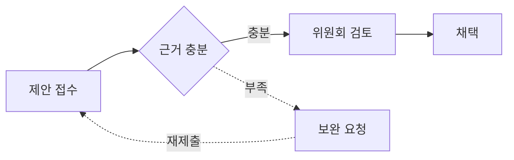

### 줄 나눔 흐름: 5단계가 넘는 과정

바깥은 위에서 아래로, 줄 안은 왼쪽에서 오른쪽으로 흐르게 한다. 줄마다 뜻이 있는 이름을 붙인다. 한 줄에 셋에서 넷이 들어가야 가로형이 된다. 단계가 넷 이하인 과정을 두 줄로 나누면 정사각이나 세로형이 되므로 그때는 앞의 가로 흐름을 쓴다.

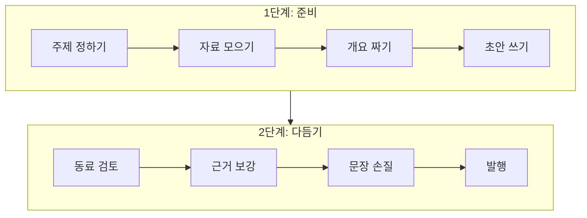

### 묶음 칸: 현재, 쟁점, 방안처럼 칸끼리 대응하는 내용

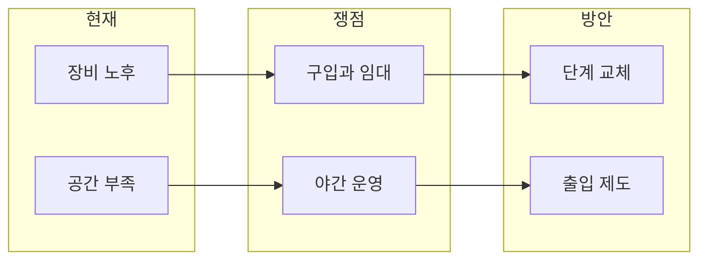

### 대비 묶음: 두 방식이 무엇을 남기고 버리는지

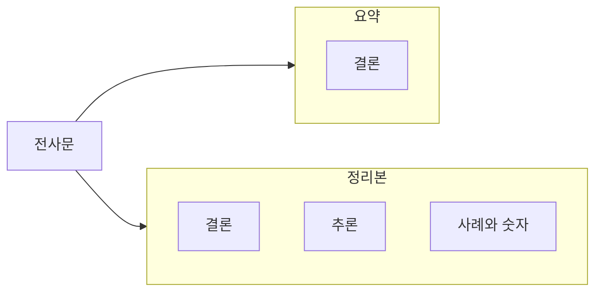

### 논증 구조: 전제에서 주장까지

`@key`는 결론 노드를 강조하고 `@interp`는 화자의 해석인 노드를 점선 테두리로 구분한다.

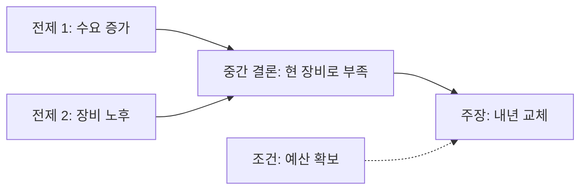

### 연표: 무슨 일이 언제

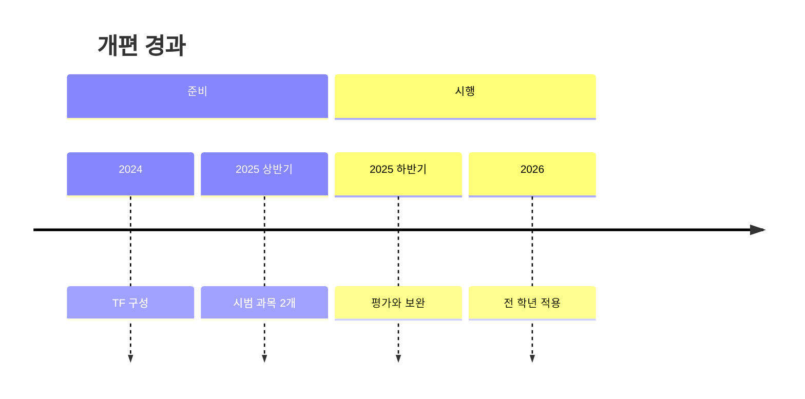

### 일정 막대: 기간, 겹침, 마감

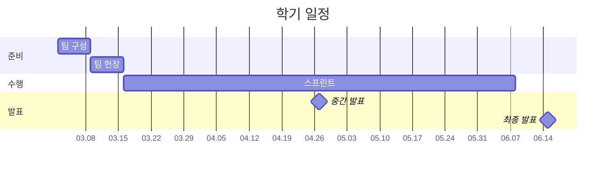

### 개념 지도: 한 개념의 갈래

갈래는 5개, 잎은 12개 안팎까지다. 라벨에 괄호를 쓰면 파싱이 깨진다.

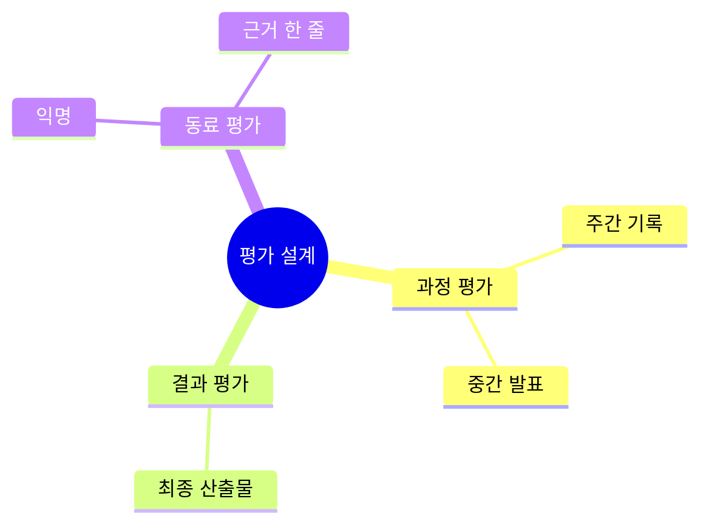

### 두 기준: 항목의 위치

화자가 두 기준으로 실제 비교했을 때만 쓴다. 좌표는 화자의 평가를 옮긴 것이며 측정값이 아니라는 점을 본문에 적는다.

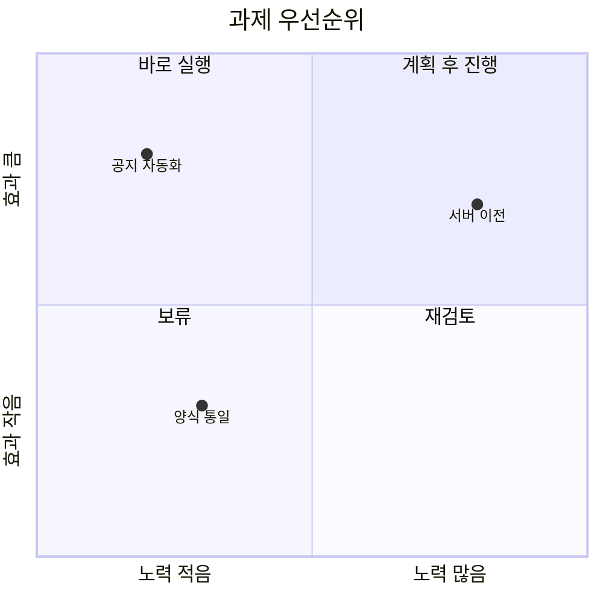

### 구조 배치: 층과 자리

열은 3개나 4개, 라벨은 짧게 쓴다. 긴 라벨은 칸 안에서 줄이 여러 번 꺾여 세로로 길어진다.

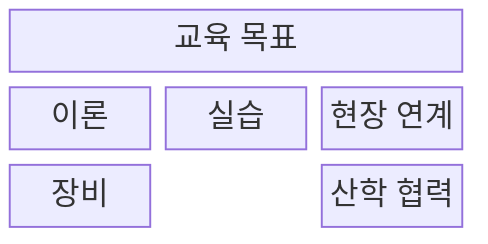

### 순서 교환: 주체 사이에 오간 것

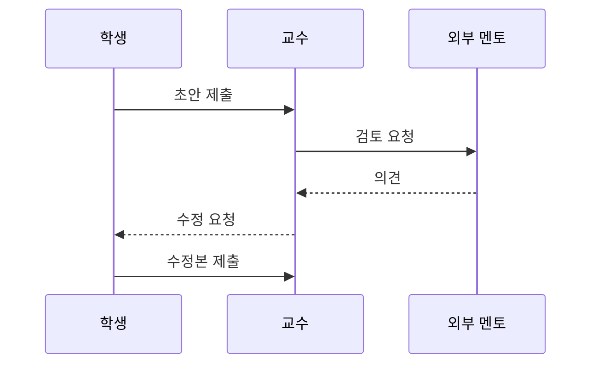

### 수량: 같은 척도의 값 비교

화자가 말한 값만 넣는다. 단위와 만점을 제목이나 축에 적는다.

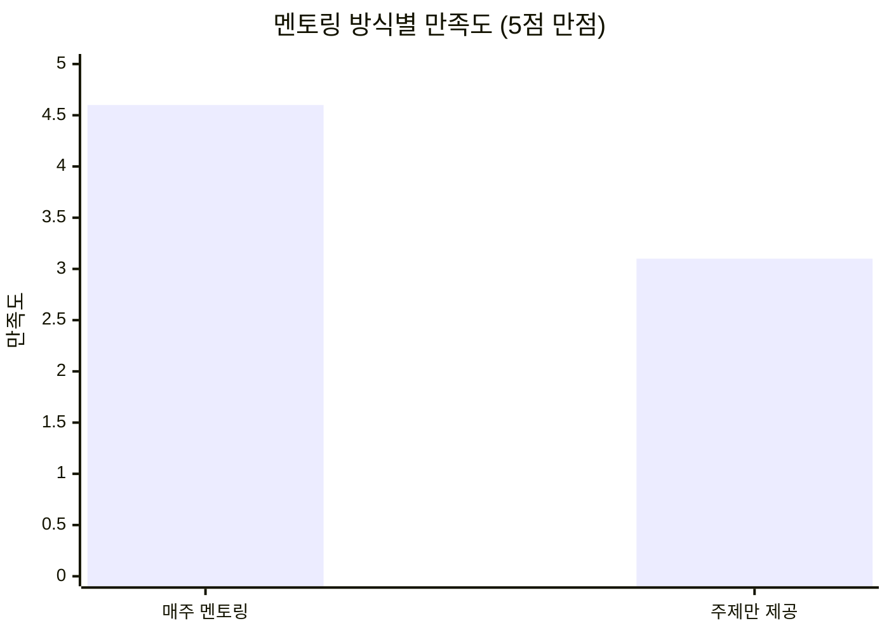

### 역할별 흐름 (Pele 대상)

```mermaid
swimlane-beta LR
    %% @caption: 산학 연계 과제의 역할 분담
    %% @alt: 학생이 주제를 제안하면 교수가 승인하고 기업이 격주로 멘토링한 뒤 학생이 결과를 발표한다
    subgraph 학생
        A[주제 제안]
        D[결과 발표]
    end
    subgraph 교수
        B[주제 승인]
    end
    subgraph 기업
        C[격주 멘토링]
    end
    A --> B --> C --> D
```

### 상태판 (Pele 대상)

안건이나 과제가 확정, 보류, 확인 중 가운데 어디에 있는지 한눈에 보인다. 회의록의 끝에 잘 맞는다.

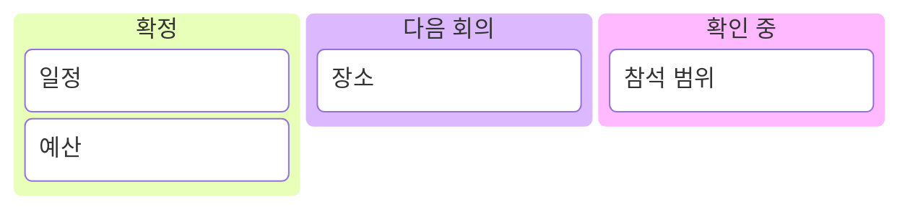

### 원인 후보 (Pele 대상)

화자가 원인으로 꼽은 것을 갈래별로 놓는다. 확인된 원인과 추측을 본문에서 구분한다.

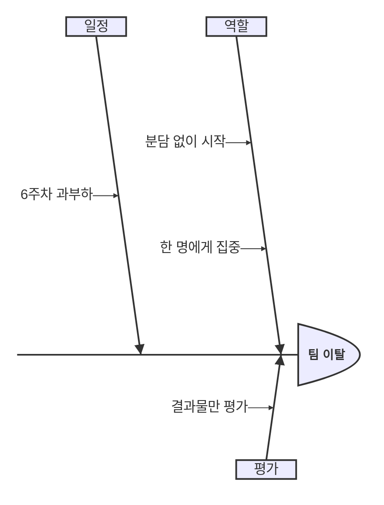

## 약한 도식을 피한다

가장 흔한 실패는 상자 네 개를 순서대로 이은 한 줄 사슬이다. "신청서 제출, 승인, 예산 지급, 운영"을 화살표로 이은 그림은 그 네 낱말을 쉼표로 이은 문장보다 알려 주는 것이 없다. 형식 검사가 이를 "한 줄 사슬 도식"으로 짚어 준다. 그럴 때 아래에서 고른다.

- 같은 내용에 모양이 더 있는지 원문을 다시 본다. 갈림(조건에 따라 달라지는 곳), 되돌아감, 주체(누가 하는지), 조건이나 단서가 있었다면 그것을 그린다. 주체가 여럿이면 순서 교환(sequenceDiagram)이, 갈림이 있으면 마름모와 선 라벨이 맞는다.
- 시간 순서일 뿐이면 연표(timeline)로 바꾼다. 시각이나 날짜가 붙어 한눈에 들어온다.
- 더할 모양이 없으면 도식을 빼고 문장으로 쓴다. 그 자리의 도식은 없는 편이 낫다.

같은 이유로 한 문서의 도식이 흐름도 하나로 쏠리면 안 된다. 도식이 다섯 개 이상인 문서라면 유형이 적어도 셋은 되어야 한다. 일정이 있으면 일정 막대나 연표가, 후보나 갈래가 있으면 개념 지도가, 주체 사이의 요청과 승인이 있으면 순서 교환이, 숫자 비교가 있으면 수량 차트가 거의 항상 하나씩 나온다.

## 정교하게 만드는 법

정교함은 상자의 수가 아니라, 읽는 사람이 문장 없이도 그림에서 요점을 집어낼 수 있는가다.

1. 그리기 전에 이 도식이 한눈에 보여 줄 문장 하나를 쓴다. 그 문장을 도식 바로 앞 문단에 넣고 `@alt`에도 넣는다. 도식 하나에 메시지 하나.
2. 주인공을 정한다. 결론이나 결정에 해당하는 노드를 `%% @key: ID`로 지정하면 강조된다. 화자의 해석인 노드는 `%% @interp: ID`, 곁가지는 `%% @aux: ID`로 구분한다.
3. 읽는 순서를 왼쪽에서 오른쪽으로 잡는다. 시작은 왼쪽 위, 결론은 오른쪽에 둔다.
4. 같은 역할의 노드를 묶고 묶음에 이름을 붙인다. 묶음의 이름도 정보다.
5. 선의 뜻을 구분한다. 실선은 화자가 말한 관계, 점선은 화자가 조건부나 잠정으로 말한 관계다. 단순한 순서가 아닌 선에는 라벨을 단다.
6. 노드는 화자의 용어로, 몇 낱말로 쓴다. 한 도식에 5개에서 12개. 그보다 필요하면 줄이지 말고 둘로 나눈다.

## 충실성

- 모든 노드와 선은 누군가 한 말로 거슬러 올라가야 한다. 선은 주장이다. 화자가 인과를 말했을 때만 인과로 그린다.
- 말하지 않은 갈림길을 채우지 않는다. "넘으면 바꾼다"만 말했다면 "안 넘으면"의 가지를 그리지 않는다.
- 도식은 문단을 대신하지 않는다. 도식에 있는 핵심은 앞뒤 글에도 있어야 한다. 도식이 그려지지 않는 곳에서도 글이 서야 하기 때문이다. "흐름은 아래와 같다"라고만 쓰고 내용을 그림에 맡기지 않는다.
- 도식 뒤에 노드를 하나씩 읽어 주는 문단을 붙이지 않는다.

## 문법

- flowchart, sequenceDiagram, stateDiagram-v2, block-beta: id는 영문과 숫자, 표시 글자는 큰따옴표 안에 쓴다. `A["라벨"]`. 라벨 안에 괄호, 대괄호, 따옴표를 쓰지 않는다. `%`와 쌍점은 괜찮다. 줄바꿈은 `<br/>`만 쓴다. `end`를 id로 쓰지 않는다.
- mindmap, timeline, kanban, ishikawa-beta: 따옴표 없이 쓰고 들여쓰기로 계층을 나타낸다. mindmap 라벨에는 괄호를 쓰지 않는다.
- timeline에서 쌍점은 칸을 나누는 기호다. 시각을 `14:00`으로 쓰면 파싱이 깨진다. `14시 00분`, `11월 24일`처럼 글자로 쓴다.
- quadrantChart: 축, 사분면, 점의 라벨은 큰따옴표 안에, 제목은 따옴표 없이 쓴다. 좌표는 0과 1 사이.
- 색과 모양을 지정하지 않는다. `style`, `classDef`, `linkStyle`, 색 이름, 이모지를 쓰지 않는다. 테마가 입힌다.
- 유형 줄 바로 다음에 `%% @caption:`(그림 제목)과 `%% @alt:`(무엇을 보여 주는지 한 문장)을 쓴다. Pele가 이를 그림의 제목과 설명으로 쓴다.
- 한글 라벨이 든 sankey는 Pele 1.6.0에서 실패한다. 값이 적힌 흐름도나 표로 바꾼다.

## 렌더 검수

문법이 맞아도 그림이 어색할 수 있다. 완성한 문서의 도식을 모두 렌더해 본다.

절차 8단계의 `check`가 렌더까지 한다. 도식만 다시 보려면 `node scripts/render_diagrams.mjs 산출물.md --out _work/diagrams --width 760`을 쓴다.

- 폭은 본문 폭이다. 노트와 보고서는 760, 한글 문서(hallym-kordoc 조판)는 680으로 준다.
- 판정은 세 가지다. **실패**(그려지지 않음), **세로형**(가로세로비 1.2 미만), **폭 초과**(본문 폭의 1.25배 초과). 하나라도 있으면 다시 짠다.
- 형식 검사가 "위에서 아래로 흐르는 흐름도"라고 주의를 주어도 렌더 판정이 통과면 그대로 둔다. 형식 검사는 원문만 보고 짐작하고, 렌더 검수는 실제 크기를 재기 때문에 렌더 판정이 우선이다.
- 다시 짜도 가로형이 되지 않는 내용이면 도식을 빼고 불릿이나 표로 쓴다. 세로형 도식을 남기지 않는다.
- 통과한 그림도 PNG를 열어 선이 상자를 가로지르지 않는지, 라벨이 잘리지 않는지, 읽는 순서가 의도대로인지 본다.
- Pele를 찾지 못해 렌더를 못 했으면 문법 검사만 했다고 보고한다. 렌더를 한 것처럼 말하지 않는다.
