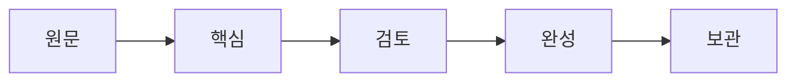

# Pele 공통 Markdown 편집기 — 0.6.1-achmage.1

회의·녹음·YouTube 정리와 내 노트의 공통 편집기에서 Mermaid 코드 블록을 Pele 1.13.0으로 표시한다. 원본 Markdown을 저장 단위로 유지한다.

- 도식 오른쪽 `</>`: 라이브 편집에서는 해당 코드 블록을 직접 편집한다. 다시 누르거나 다른 문단·화면으로 초점을 옮기면 도식으로 돌아간다.
- `복사`: Mermaid fence를 포함한 코드 블록을 복사한다. 문단 구분용 후행 빈 줄은 포함하지 않는다.
- 읽기에서는 `</>`로 원문을 확인하고 다시 누르면 도식으로 돌아간다. 전체 `원문` 모드도 유지한다.
- 일반 노드·선·글자는 스킨에 맞춰 렌더링한다. 아래 클래스는 선택한 상자만 강조한다.

`achmage`는 현재 스킨 강조색을 따른다. 나머지는 고정 파랑·청록·남색이다. Mermaid의 `style`과 `classDef`에 명시한 색도 유지한다. `classDef`에 CSS `var(...)`를 직접 쓰면 현재 Pele parser가 거부하므로 동적 색은 위 클래스를 사용한다.

오류가 있는 도식도 코드와 복사 버튼을 보존한다. Mermaid의 외부 링크·이미지 기능은 비활성화하고 SVG를 추가 정화한다. 도식 처리에는 AI 호출이 없다. 원본 MD를 렌더링 과정에서 다시 직렬화하지 않는다.

CodeMirror 블록 위젯의 바깥 여백은 높이 계산에서 누락되어 클릭 위치가 어긋날 수 있다. 도식 위젯의 바깥 여백을 없애고 소스 도구막대는 padding을 사용한다. 원문 줄 높이를 일정하게 유지한다.

## 검증

- Electron E2E: 소스/도식 전환, 코드 복사, 부분 색상, 테마 변경, 편집·자동 저장·undo, 외부 초점 이동, 읽기 모드, 내 노트, 재실행 후 원문 보존.
- 잘못된 문법의 원문 유지, 외부 링크/이미지 요청 차단 확인.
- 실제 KPF 최종 MD 3개의 도식 20개가 Pele에서 렌더링됨. 원본 문서는 변경하지 않음.
- Linux 실행 검증. Windows/macOS는 패키지 교차 빌드이며 실기기 검증과 다름.

공식 API: https://pele.run/api · 테마: https://pele.run/theming · 보안: https://pele.run/security · 호환성: https://pele.run/compatibility

이 변경은 Obsidian 설치나 플러그인을 요구하지 않는다. Pele의 모든 Mermaid 확장 문법·배치를 기존 Mermaid와 동일하게 보장하지 않는다.

검증 연구: `research:rr-f9fffb352cd23c941446e3d800c00c71:1b49f7171fb1a38d3fbfce0191be0c97286de6e9b3f1981dacbe8874189613ac`.
